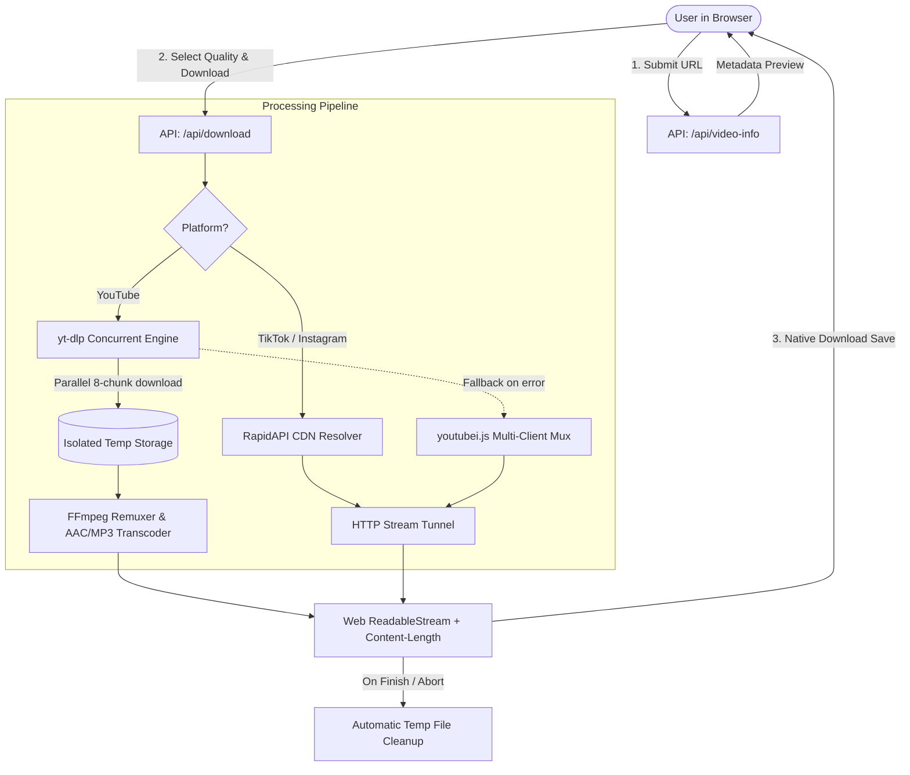

# ClipDrop 🎬

**ClipDrop** is a high-performance, full-stack media extraction platform designed to seamlessly download high-definition video and audio from **YouTube**, **TikTok**, and **Instagram**. Engineered for speed, compression efficiency, and resilience, it combines modern web technologies with an advanced multi-threaded media processing pipeline.

---

##  Key Features

- **Multi-Platform Extraction**:
  - **YouTube**: Downloads videos at 720p, 480p, or 360p with high-efficiency AV1/VP9 compression, and pristine 192kbps MP3 audio.
  - **TikTok**: Instant high-definition video downloads with watermarks completely removed.
  - **Instagram**: High-speed extraction for Reels and video posts using an active dual-API fallback architecture.
- **Ultra-Fast Parallel Downloads**: Powered by concurrent fragment multi-threading (8 simultaneous connections) that saturates available network bandwidth and downloads full-length videos in seconds.
- **Smart Codec Optimization**: Prioritizes AV1 and VP9 codecs for up to **50% smaller file sizes** with zero perceptible loss in video quality compared to legacy H.264.
- **100% Audio/Video Synchronization**: Advanced container multiplexing ensures AAC audio tracks remain perfectly synchronized and never mute or drop out near the end of videos.
- **Interactive Download Manager**: Real-time floating task cards with animated progress states, celebratory confetti, and manual download fallbacks.
- **Instant Metadata Preview**: Fetches video titles, author details, avatars, and high-resolution thumbnails before downloading.
- **Browser-Native Save Dialogs**: Same-origin tunnel route with standardized `Content-Disposition` and `Content-Length` headers for seamless native browser downloads without CORS restrictions.
- **Self-Cleaning Storage**: Automated lifecycle management that removes temporary media immediately after delivery and runs garbage collection for old temporary files.

---

##  Technologies Used

### 1. Web Framework & Runtime
- **[Next.js 15 (App Router)](https://nextjs.org/)**: Full-stack framework utilizing React Server Components, server actions, and Route Handlers (`/api/download`, `/api/video-info`) for high-throughput media proxying and streaming.
- **[React 19](https://react.dev/)**: Frontend library powering the user interface with modern hooks, declarative state, and fluid UI updates.
- **[Node.js (v20+)](https://nodejs.org/)**: Asynchronous server runtime providing non-blocking file I/O, process management via `child_process.spawn`, and stream conversion via `stream/promises`.
- **[TypeScript 5](https://www.typescriptlang.org/)**: End-to-end static type safety across API contracts, downloader adapters, metadata structures, and UI components.

### 2. Styling, Motion & Design System
- **[Tailwind CSS v4](https://tailwindcss.com/)**: Utility-first CSS engine delivering a sleek dark-mode aesthetic with custom glassmorphism, responsive grids, and tailored design tokens.
- **[Framer Motion](https://www.framer.com/motion/)**: Production-grade animation library powering the floating download manager, notification cards, layout shifts, and micro-interactions.
- **[tailwindcss-animate](https://github.com/jamiebuilds/tailwindcss-animate)**: Keyframe animations for loading spinners, pulses, and smooth component entry effects.
- **[Lucide React](https://lucide.dev/)**: Crisp, lightweight vector iconography for media formats, status badges, platforms, and controls.
- **[Canvas Confetti](https://github.com/catdad/canvas-confetti)**: Canvas-driven particle physics animations triggered upon successful download preparation.

### 3. Media Processing & Extraction Engines
- **[yt-dlp (Python)](https://github.com/yt-dlp/yt-dlp)**: Primary high-speed media extraction engine. Configured with `--concurrent-fragments 8`, multi-part chunking, player challenge solvers (`--remote-components ejs:github`), and multi-layer format selection.
- **[FFmpeg](https://ffmpeg.org/)**: Multimedia framework responsible for:
  - Remuxing separate video and audio streams into standard MP4 containers.
  - Transcoding audio tracks to AAC (LC 128kbps) to guarantee universal playback across Windows Media Player, QuickTime, iOS, and Android.
  - Converting high-bitrate YouTube audio streams into standalone, tagged MP3 files at 192kbps.
- **[youtubei.js (Innertube)](https://github.com/LuanRT/YouTube.js)**: Secondary YouTube fallback engine communicating directly with YouTube's internal APIs (Android, iOS, MWEB client types) with dynamic player cipher deciphering (`Platform.shim.eval`).
- **[bgutils-js](https://github.com/LuanRT/bgutils-js)**: Google BotGuard and Proof of Origin (PO Token) generation utilities for anti-bot verification and rate-limit evasion.
- **[jsdom](https://github.com/jsdom/jsdom)**: Headless browser DOM environment used by backend engines for runtime signature challenge resolution.
- **[RapidAPI](https://rapidapi.com/)**: REST API gateway providing redundant connections to TikTok (watermark remover) and Instagram Reels extractors.

### 4. HTTP Networking & Streaming Utilities
- **[content-disposition](https://github.com/jshttp/content-disposition)**: Generates RFC 6266 and RFC 5987 compliant HTTP headers to ensure downloaded files save with sanitized, proper filenames across all browsers.
- **Web Streams API (`ReadableStream`) & Node Streams**: Enables efficient streaming of multi-megabyte media files from disk directly to HTTP response bodies without excessive RAM consumption.

---

##  Architecture & Engineering Highlights



### 1. High-Speed Concurrent Fragment Engine
Rather than relying on real-time stdout pipes that suffer from YouTube's ~1.7x playback throttling and connection drops on 15–20 minute videos, ClipDrop uses multi-threaded chunking (`--concurrent-fragments 8`). It fetches video and audio fragments simultaneously across multiple TCP sockets at full line speed (25–35+ MB/s), then assembles the final file locally in seconds.

### 2. Next-Gen Codec Priority & Compression
To eliminate bloated files while preserving crisp visual detail, the extraction filter enforces strict codec prioritization:
1. **AV1 (`vcodec^=av01`)**: Cutting-edge compression yielding up to 50% smaller files than H.264 at identical visual fidelity.
2. **VP9 (`vcodec^=vp09`)**: High-efficiency fallback providing ~35% bandwidth savings.
3. **AVC1 / H.264**: Universal fallback ensuring broad legacy device compatibility.

### 3. Audio Continuity & Synchronization
Live-streamed fragmented MP4s frequently mute in media players near the end of playback due to track timescale drift or missing audio packets in late video fragments. ClipDrop resolves this by merging complete local files with FFmpeg and explicitly encoding the audio track as standard **AAC (LC, 128kbps)** with clean `moov` atom headers, ensuring persistent sound from start to finish.

### 4. BotGuard & Anti-Bot Evasion
To bypass YouTube's BotGuard challenges and `403 Forbidden` CDN errors:
- Rotates requests through non-desktop client personas (`ANDROID`, `TVHTML5`, `IOS`, `MWEB`).
- Dynamically resolves player signature ciphers (`s-sig`) and `n-token` throttling transforms on the fly.
- Configures comprehensive retries for transient fragment drops.

---

## Project Structure

```
Youtube-Downloader2.1-main/
├── src/
│   ├── app/
│   │   ├── api/
│   │   │   ├── download/
│   │   │   │   └── route.ts        # Media download engine (yt-dlp, FFmpeg, tunneling)
│   │   │   └── video-info/
│   │   │       └── route.ts        # Metadata resolver route
│   │   ├── layout.tsx              # Root HTML layout, SEO meta tags, fonts
│   │   └── page.tsx                # Main view with input, preview & download manager
│   ├── components/
│   │   ├── DownloadManager.tsx     # Floating notification queue with progress bars
│   │   ├── DownloadOptions.tsx     # Format & resolution selector (720p, 480p, MP3)
│   │   ├── Hero.tsx                # Hero section with animated headings
│   │   ├── History.tsx             # LocalStorage recent downloads history
│   │   ├── Navbar.tsx              # Header with branding and quick links
│   │   └── VideoCard.tsx           # Video thumbnail, creator information & preview
│   ├── context/
│   │   └── DownloadContext.tsx     # Global download state, task queue & triggers
│   └── lib/
│       └── downloader.ts           # Unified platform metadata extractor
├── public/                         # Static assets and icons
├── package.json                    # Project dependencies and npm scripts
└── README.md                       # Documentation
```


##  License

This project is open-source and available under the [MIT License](LICENSE).
